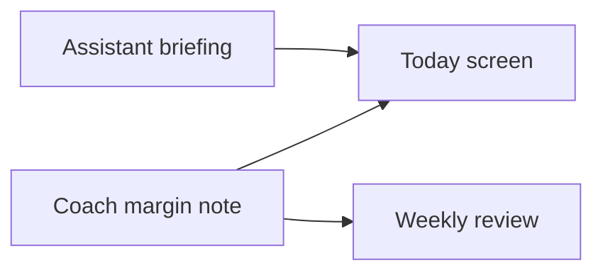
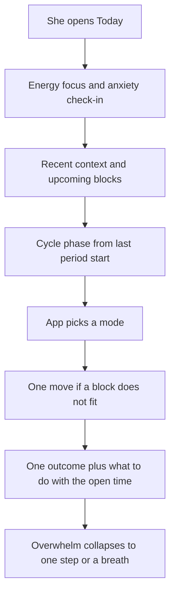
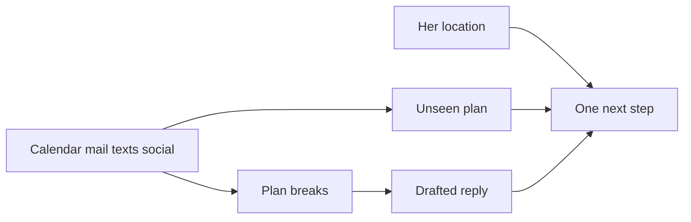

# Cycle capacity

Working spec for a demo. The repo is [unnamed_productivity_app](https://github.com/possiblyphilip/unnamed_productivity_app). This document is the demo contract. The app itself waits until someone asks for it.

## Thesis

Match the kind of work to today’s capacity. Capacity is a body rhythm (a menstrual cycle, when she uses one) plus how she feels right now, plus what just happened (a meal, a late night, a workout), plus what is already on the schedule.

Kyra is user one. She already keeps a manual plan for her cycle, her creative windows, and her food, and she wants help with focus, follow-through, and feeling overwhelmed. The same shell still makes sense for someone without a cycle: high-energy days are for starting and connecting, low-energy days are for a different kind of work.

This round is a demo of that loop. It opens onto a sample morning that already feels lived-in. Her real protocol can replace the sample later. The demo does not ask anyone to log a period, invent tasks, or connect an account before the assistant has something to say.

This is a planning aid. Phase cards, food cards, and breathing exercises are user-authored sample copy. They are not medical advice, a diet, or treatment for ADHD, anxiety, or any mood disorder.

## Two roles

The product is part personal assistant and part life coach. They have different jobs.

**Assistant, always on.** It briefs the day, looks ahead at upcoming blocks and recent context, and when something does not fit it says so in one operational line. It names the block, why that slot is poor, where to move it, and what to do with the time that opens. One tap accepts the move and rewrites the schedule. Dismiss keeps the block and hides that suggestion until the context changes (the check-in, a context chip, or the block itself).

The voice is operational. The judgment is the coaching.

- “Workout is at 8:15. You ate 40 minutes ago. Move it to 5:30pm. Use 8:15 for a short admin pass: answer the two emails.”
- “Deep work is at 11. Energy is low and this phase wants finishing, not starting. Move it to Thursday at 2:00pm. Use 11:00 to finish the scene.”
- “Three late nights in a row. Drop the 6:30am start. First block moves to 9:00 and stays light.”

In this demo the assistant speaks when she opens the app. It does not buzz the phone. An assistant that interrupts all day is the habit this product is walking away from.

**Coach, off unless she turns it on.** It adds the lesson under a move the assistant already made: why this phase wants finishing, how today’s outcome serves the week, a smaller first step, a creative starter. Education, goal alignment, tutorials, and light quests live here. The longer form is the weekly review. The coach does not diagnose, treat, or try to motivate her out of a low day.

She can take every move and never meet the coach. Turning the coach on adds a why under the move. It does not add a second plan.



## Capacity

```text
capacity = rhythm phase + today's check-in + recent context + upcoming blocks
```

The check-in is three levels each: energy, focus, anxiety. Low, medium, or high.

Cycle phase is optional. With no period logged, the mode comes from the check-in alone. With a period logged, phase suggests a mode and the check-in can override it.

## Daily loop



At most one move is on screen. If several blocks clash, the assistant picks the soonest block that has not started yet, relative to the demo clock. Accepting it rewrites the schedule and the next clash can appear. Dismissing it leaves the block where it is.

## Modes

She can override the mode. The assistant’s move logic uses the mode on screen.

| Mode | Plain meaning | Usual phase fit |
| --- | --- | --- |
| Start | New work, learning, harder training | Follicular |
| Connect | Conversations, collaboration, outward creative work | Ovulatory |
| Finish | Close loops, details, shorter blocks | Luteal, and the default when she feels frazzled |
| Recover | Fewer commitments, food and rest, no new projects | Menstrual, or a very low check-in |
| Make | A protected creative block | When phase and energy agree |

Mode selection, in order:

1. Menstrual phase sets Recover. Follicular sets Start. Ovulatory sets Connect. Luteal sets Finish. No period logged skips this step and starts at Finish.
2. Energy low and focus low sets Recover.
3. Energy low or anxiety high, on a Start or Connect day, sets Finish. A follicular morning she marks as overwhelmed becomes a short Finish day. The demo morning is luteal with energy low, focus medium, and anxiety high, so the mode stays Finish.
4. A creative block that continues work already started can sit inside a Finish day. Make is the mode for the day only when energy is high and the phase already favors starting or connecting.

If the coach is on, one sentence under the mode says why. That sentence can be turned off. The briefing stays.

## Context chips and timing rules

Chips are one tap and timestamped: **ate**, **workout**, **late night**.

Seed rules, all editable from Settings:

| Rule | Seed | What the assistant does |
| --- | --- | --- |
| Meal gap | 90 minutes | A body block inside the gap after **ate** moves to the next free body slot. Seed landing time is 5:30pm the same day, if that slot is free. The opened time becomes a short admin block. |
| Late nights | 3 in a rolling three-night window | Any block that starts before the morning cutoff moves to the cutoff, and its type becomes admin. Seed cutoff is 9:00am. |
| Low-energy new start | Today’s energy is low and the mode is Finish or Recover | A deep block whose title is a new start moves to the next free afternoon at least one day out. Seed landing is 2:00pm two days out. The opened time becomes finishing work already in progress. |
| Morning already early | A block before the cutoff is still on the schedule | Later morning blocks stay admin or finish. The assistant does not add a second deep block before noon. |

When one block matches more than one rule, the reason shown is the first match in this order: meal gap, low-energy new start, late nights. That is why the sample 8:15 workout speaks about breakfast, even though it is also before 9:00am.

Passed blocks produce no move. A dismissed suggestion stays hidden until the check-in, a chip, or that block changes.

## Where the coach speaks

On Today, and only if Coach is on: one why-line under the current move, one line on how today’s outcome serves the week, and a creative starter if the open block is creative and she has not begun. The demo ships Coach off, with the why-line already written.

The weekly review is the coach’s other surface. It shows what got finished, what slipped, and one adjustment for next week. The tone stays factual. Skipping the review changes nothing about the next briefing. The assistant does not host this screen.

Light play is off by default and belongs to the coach: a phase quest such as “finish one thing” or “start one thing.” A missed day is a blank day. There is no streak to break.

## Screens and what they store

The demo is one static site: HTML, CSS, and plain scripts, no build step, so `index.html` opens from the Files app and the same files can sit on GitHub Pages. Add to Home Screen is the install. State lives in `localStorage` under one key. Reset demo restores the sample morning. Export downloads that state as JSON. Import replaces it.

### Today

Shows phase and cycle day, mode, the check-in, context chips, the one move with Accept and Dismiss, today’s outcome, up to three fitting tasks, the nutrition card, the creative-window line, and Overwhelm. A small label reads “Sample morning.”

Stores nothing of its own. It reads the state below.

### Check-in

Three controls, low / medium / high, for energy, focus, and anxiety. Changing them recomputes the mode and the move.

### Schedule

Blocks with a start, an end, a day offset from the open date, a type, and a title. Types are `deep`, `admin`, `creative`, `body`, and `social`. Each type has a phase fit used by the rules. This list is the schedule. There is no phone calendar in the demo.

### Tasks

A short list with the same types. Tasks that fit the current mode show on Today, up to three. The others stay on the list under “Later this cycle.”

### Cycle

Period start, four phase lengths, and an advice card per phase. Cycle day is the number of days since period start, plus one, wrapped by the sum of the lengths.

### Nutrition

One card per phase in the demo. The Today screen shows the card for the current phase. Sample copy is labeled as a sample. The card does not calculate macros.

### Horizons

Season, month, week, and today. She can edit each line. The assistant uses the week line only as the target of the coach’s horizon sentence.

### Weekly review

Two or three stored lines: finished, slipped, adjustment. In the demo these are prewritten.

### Regulate

Overwhelm hides the list and shows one next physical step, plus a breathing exercise. Who chooses the exercise: her, the app, or surprise.

- She picks from the list.
- The app, when anxiety is high, picks extended exhale. When anxiety is low, it picks box breathing. Otherwise it picks a physiological sigh.
- Surprise picks from the three at random.

Seed exercises:

- **Physiological sigh.** Two short inhales through the nose, one long exhale through the mouth. Four rounds.
- **Box breathing.** Inhale, hold, exhale, hold, each for four counts. Four rounds.
- **Extended exhale.** Inhale for four counts, exhale for six. Six rounds.

Copy on the screen: stop if it feels worse.

The demo’s next physical step, before any move is accepted, is: “Read the last paragraph of the scene.” After the workout move is accepted, it becomes: “Open mail and answer the two emails.”

### Settings

Coach on or off. Light play on or off. The four timing-rule numbers. Morning cutoff. Export, import, and Reset demo.

## Sample morning

Dates are offsets from the day the demo is opened. The clock is frozen at 7:40am, so the story still reads if someone opens it in the afternoon. “Thursday” in the examples below is the weekday name of the day two days out. Open the demo on a Tuesday and that day is Thursday.

Reset demo returns every value in this section.

### Already true at 7:40am

- Period start was 21 days ago. Cycle day 22. Phase is luteal. Mode is Finish.
- Check-in: energy low, focus medium, anxiety high.
- Breakfast logged today at 7:00am. No workout logged today. Late nights logged on each of the previous three nights.
- Coach off. Light play off.
- Why-line waiting: “Late luteal plus a low-energy morning is a finishing day. Starting a new essay opening fights that. The scene is already in motion.”
- Horizon line waiting: “Finishing the scene today serves the week: ship the winter essay draft.”

### Horizons

- Today: finish the scene.
- Week: ship the winter essay draft.
- Month: close the winter essay and one small collab.
- Season: one creative window a day through the dark months.

### Blocks

| Day offset | Time | Type | Title |
| --- | --- | --- | --- |
| 0 (today) | 8:15–9:00 | body | Strength workout |
| 0 | 11:00–12:30 | deep | New essay opening |
| 0 | 16:00–17:00 | creative | Finish the scene |
| 1 (tomorrow) | 6:30–8:00 | deep | Early start |
| 2 | 14:00–16:00 | free | Open afternoon, the landing slot for the essay |

### How the moves unfold

1. Soonest clash is the 8:15 workout. It falls inside 90 minutes of breakfast. The move: shift Strength workout to today 17:30–18:15, and put “Answer the two emails” (admin, 8:15–9:00) in its place.
2. After that accept, the next clash is 11:00 “New essay opening.” Energy is low and the mode is Finish. The move: shift it to day-offset 2 at 14:00–15:30, and put “Finish the scene” (creative, 11:00–12:30) in its place. The 16:00 creative window stays.
3. After that accept, the next clash is tomorrow’s 6:30 deep block. Three late nights are logged. The move: shift it to 9:00–10:30 and change its type to admin, title “Light pass.”

Dismissing any one of these leaves that block in place and shows the following clash.

### Tasks

| Title | Type | On Today at open |
| --- | --- | --- |
| Finish caption edits | admin | Yes |
| Pack lunch | admin | Yes |
| Start a new series | deep | Later this cycle |
| Pitch a collab | social | Later this cycle |

Today’s third slot stays open, so the screen shows two fitting tasks. The cap is three.

### Nutrition card on screen

Luteal, labeled sample: “Lunch: rice, eggs, greens, and yogurt. A higher-carb sample for this phase.”

### Weekly review already written

- Finished: finished the caption pass for the short piece.
- Slipped: the morning workout did not happen.
- Adjustment: keep new writing for the afternoon this week.

## Seed cycle

A 28-day split is the seed. Lengths are editable. Advice cards ship as sample copy she can replace.

| Phase | Days in the seed | Mode | Sample advice |
| --- | --- | --- | --- |
| Menstrual | 1–5 | Recover | Keep the list short. One admin block is enough. Gentle movement if she wants it. |
| Follicular | 6–13 | Start | A good window for new work and harder training. Start the thing the week is actually about. |
| Ovulatory | 14–16 | Connect | Conversations, pitches, and outward creative work fit. Protect one social or collaborative block. |
| Luteal | 17–28 | Finish | Finish what is already open. Shorter blocks. New starts wait for a higher-energy afternoon or the next cycle. |

Day 22 falls in luteal. Cycle day is `((days since period start) mod 28) + 1`, using the edited lengths once their sum replaces 28.

Phase nutrition cards, each one sentence, each labeled sample:

- Menstrual: warm bowl, iron-rich food she already likes, and a snack she does not have to cook.
- Follicular: a normal training day of protein and carbohydrates around the harder session.
- Ovulatory: the same pattern as follicular. Eat before a long social block.
- Luteal: the rice, eggs, greens, and yogurt card above.

## Attention and anxiety

The demo is built around a frazzled morning, so these behaviors are part of the sample, not a settings buried later.

- One outcome for the day. The sample outcome is “finish the scene.” The schedule can hold more than one block. The outcome stays a single line.
- Later this cycle holds misfit tasks so the backlog still exists and stays off the morning.
- One move, then the next. Suggestions arrive singly.
- Overwhelm replaces the list with the next physical step and offers a breath.
- Missed days and dismissed moves carry no penalty and no streak.
- Education is the coach, and the coach ships off.

## Privacy and the phone

“Download and run in the browser” means no account, no server, and no App Store install.

- The public repo contains the app. The sample morning, and any edit she makes, stay in `localStorage` on that phone.
- Real reminders that fire while the app is closed need a push server. This demo does not include one. The briefing is what she sees when she opens it.
- Mail, contacts, Health, calendars, and cloud drives are not available to a page she downloads. Export and import are the bridge.
- A later model, if she wants one, is bring-your-own-key and off by default. It may phrase a move the rules already chose. It may speak as the coach when she opens the coach. The spec for that later step is: send today’s mode and the titles of today’s blocks, and leave cycle notes on the device unless she includes them. Today stays the assistant’s briefing. Chat is not the home screen.

There is no chatbot in the demo. Both voices are rules she can read in Settings. They work with the phone offline after the page is loaded.

## State shape

One JSON object. Offsets are days from the open date. Times are `HH:MM` on the frozen demo clock, whose “now” is 7:40.

```json
{
  "demoClock": "07:40",
  "label": "Sample morning",
  "coachOn": false,
  "playOn": false,
  "rules": {
    "mealGapMinutes": 90,
    "lateNightCount": 3,
    "lateNightWindowNights": 3,
    "morningCutoff": "09:00",
    "bodyLanding": "17:30",
    "deepLanding": { "dayOffset": 2, "time": "14:00" }
  },
  "checkIn": { "energy": "low", "focus": "medium", "anxiety": "high" },
  "chips": [
    { "kind": "lateNight", "dayOffset": -3 },
    { "kind": "lateNight", "dayOffset": -2 },
    { "kind": "lateNight", "dayOffset": -1 },
    { "kind": "ate", "dayOffset": 0, "time": "07:00" }
  ],
  "cycle": {
    "periodStartOffsetDays": -21,
    "phases": [
      { "id": "menstrual", "days": 5, "mode": "Recover" },
      { "id": "follicular", "days": 8, "mode": "Start" },
      { "id": "ovulatory", "days": 3, "mode": "Connect" },
      { "id": "luteal", "days": 12, "mode": "Finish" }
    ]
  },
  "blocks": [
    { "dayOffset": 0, "start": "08:15", "end": "09:00", "type": "body", "title": "Strength workout" },
    { "dayOffset": 0, "start": "11:00", "end": "12:30", "type": "deep", "title": "New essay opening", "newStart": true },
    { "dayOffset": 0, "start": "16:00", "end": "17:00", "type": "creative", "title": "Finish the scene", "newStart": false },
    { "dayOffset": 1, "start": "06:30", "end": "08:00", "type": "deep", "title": "Early start", "newStart": true }
  ],
  "tasks": [
    { "title": "Finish caption edits", "type": "admin", "fit": "today" },
    { "title": "Pack lunch", "type": "admin", "fit": "today" },
    { "title": "Start a new series", "type": "deep", "fit": "later" },
    { "title": "Pitch a collab", "type": "social", "fit": "later" }
  ],
  "horizons": {
    "today": "finish the scene",
    "week": "ship the winter essay draft",
    "month": "close the winter essay and one small collab",
    "season": "one creative window a day through the dark months"
  },
  "review": {
    "finished": "Finished the caption pass for the short piece.",
    "slipped": "The morning workout did not happen.",
    "adjustment": "Keep new writing for the afternoon this week."
  },
  "coachCopy": {
    "why": "Late luteal plus a low-energy morning is a finishing day. Starting a new essay opening fights that. The scene is already in motion.",
    "horizon": "Finishing the scene today serves the week: ship the winter essay draft."
  }
}
```

`newStart` marks deep work that the low-energy rule is allowed to move. “Finish the scene” is creative work already in progress, so it is a legal replacement, not a clash.

## The app is the plan

She checks this one app instead of the calendar, the inbox, and the texts. The long-term plan lives underneath and is not shown. Goals, the rest of today, and the reason for a step stay backstage. The screen is the next physical step, and nothing else.

“Get dressed for yoga and put a pullover sweater in your bag.”

The sweater is in the instruction because lunch with a friend is next and she will want it after class. That reason stays backstage. She puts the sweater in the bag. When she marks the step done, the next one appears. One at a time is how the unseen plan gets her where she meant to go.

Location decides which prepared step is allowed on screen. The app can know the route and the menu long before she needs them. It shows each one only at the moment and the place it is useful.

- At home, before it is time to leave: the sweater.
- When it is time to go to yoga: Google directions are already up, studio filled in. She does not search.
- At the studio: the route is gone. The step is the class.
- When it is time to go to lunch: directions to the restaurant are already up, the same way.
- When she is there: “The chicken salad would be nice.” The menu was read ahead and held. It stays hidden in the car and at yoga.

If lunch moves, the old route and the old menu pick are dropped, the reply is drafted, and the new place gets its own directions and its own held order.

The demo is a short choose-your-own morning. One card, two to four choices. The guide does not police and does not mark a right answer. A simulated reading sits in the bottom band only while the choice it belongs to is on the card, and the band holds two at most. Oura's short night shows with Sleep. Her cycle reads as the ovulatory phase, and that reading stays with eating or with Flirt with a friend. The same rule covers Google Calendar, Garmin, astrology, and the weather. After a choice, a quiet note says which horizon that choice touches, today, this week, this month, or beyond, and only the horizons that apply. The end of the run is that report. She can leave a prompt on to look at it later, or turn prompts off and open it when she pleases. Nothing in the demo uses alarm language or alarm color. The long intake interview is not in this demo. The colors are sage `#667F70` for most of the screen and soft sage `#B9C9BF` for the choice panel. She may hand-draw the next visual pass.

### What it holds back

Messages, email, social, and the rest of the calendar stay held. The morning has no count, no badge, and no “twelve things can wait.” A number is still something to watch.

### When it jumps in

It interrupts only when the world changes the plan she is already in. Two cases:

- A friend writes that lunch has to move.
- A flight is delayed.

The screen then replaces the next step with the change, and a drafted reply she can send. “Lunch moved to 1. Tell Maya you’ll be there at 1:15, still coming from yoga.” She sends it or edits a word. She does not open the thread. The next step updates after that. The sweater might come out of the instruction, or the time to leave might move. Everything else stays held.

A buzz is allowed for that interruption and for the moment the next step is due. It is not allowed for mail, social, or the rest of the day. That is the whole notification policy.



### Under the hood

Who, what, when, where, why, and how are how the plan is stored. How is the only one she sees.

- **Who** can change the plan: the friend at lunch, the airline, a partner, a child, a doctor.
- **What** the stretch of days is taking her toward.
- **When** the next real commitment is, including lunch after yoga.
- **Where** she is right now, which is the lock on the step. Directions appear when it is time to leave and she is not there yet. The menu pick appears when she has arrived. The sweater is packed at home because of where she is going later.
- **Why**, kept off the screen, including cycle, energy, and the lunch that follows.
- **How**, the one line on the screen.

Body, people, work, money, home, and creative stay labels for sorting what comes in. They are not screens.

### Shapes that would add a thing to watch

These stay out even after the accounts connect:

- The route, the menu, or the next place before she is at the moment for it.
- The rest of today’s schedule on the home screen.
- The reason written under the step.
- A held count, a badge, or message text beside the step.
- A unified inbox, or mail, texts, and social opened inside the app.
- A grid of life areas to review.
- The coach on the way to the next step.

### Order, after the demo

The sample morning stays local and talkative, with no accounts and no location. The first pipes are one calendar and location, because the next step is derived from both: yoga, then lunch, therefore the sweater at home, the route when it is time to leave, the chicken salad only once she is at the table. Mail and texts stay silent until one of them changes that step, and then the app drafts the reply. A downloaded page can open Google Maps with the destination already set when she taps the leave-step. Putting directions on screen by itself, while the phone is locked, needs the later app. A downloaded page still cannot read her texts. Location and menu lookup are a separate decision about data leaving the phone: the place can stay on the device and only the destination or the restaurant name goes out to fetch a route or a menu. The screen stays one step.

## Later

Recorded so the wider idea stays in the repo, and out of this demo. Connectors feed the unseen plan. The home screen stays the next step.

- A buzz when the next step is due, and a buzz when the plan breaks, with a drafted reply. Other notifications stay off. That needs a server, so it is a separate decision about data leaving the phone.
- One calendar read into the next step, plus location so the route and the menu pick each wait for their moment. Then mail and texts only as interrupts that change the step.
- Usage limits in the spirit of muting every app except this one. A downloaded page cannot do that to the rest of the phone.
- Fitness and nutrition-tracker import, as facts the unseen plan can fold into the next step. Weather folds in the same way. The sweater, the route, and the chicken salad are that kind of fact.
- A tutorial shelf and richer game loops, behind the curtain, off the step.
- Accounts and sync across phones.
- A bring-your-own-key model that phrases the step and the drafted reply, under the privacy limit above. It does not invent a second plan.
- Her real phase lengths, her real food cards, and her real week, swapped in for the sample morning.
